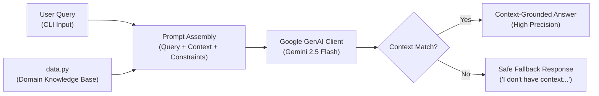

# 🤖 Mini-LLM Execution Engine & Context-Grounded QA Agent

[](https://python.org)
[](https://aistudio.google.com)
[](#)
[](#)

A context-grounded Question-Answering (QA) agent engineered with the official **Google GenAI SDK (`google-genai`)** and **Gemini 2.5 Flash**. This module demonstrates prompt engineering techniques, deterministic context injection, and hallucination containment for enterprise knowledge retrieval.

---

## 📌 Module Architecture

```text
LLM/
├── 📄 Agent.py          # Primary CLI orchestration agent & Gemini API inference engine
├── 📄 data.py           # Domain knowledge base & grounding context definition
├── 📄 llm_agent.py      # Extensible agent interface & future tool-calling hooks
├── 📄 .env              # Local environment configuration (Gemini API key)
└── 📄 README.md         # Engine architecture & operational documentation
```

---

## ⚙️ How It Works: Context-Grounded Prompt Engineering

Standard LLMs tend to hallucinate when asked domain-specific organizational questions. This engine mitigates hallucination through **prompt-level grounding constraints**:



### Prompt Guardrails (`Agent.py`):
```python
prompt = f"""
    Your task is to answer the following questions related to the company
    and services based on the provided context.
    Use the context to find relevant information and provide accurate answers,
    however make research on the data given to you and elaborate the answers.
    And if you can't find any relevant context, respond with "I don't have context..."

    Question: {user_prompt}
    Context: {context}
"""
```

---

## 🛠️ Key Capabilities & Technologies

1. **Modern Google GenAI Client (`google-genai`):**
   - Uses `genai.Client(api_key=...)` and `client.models.generate_content(model="gemini-2.5-flash", contents=prompt)` for sub-second, low-latency completions.
2. **Zero-Hallucination Fallback:**
   - Explicit negative instruction ensures the model does not invent fictitious facts outside the injected corporate domain context.
3. **Decoupled Knowledge Layer (`data.py`):**
   - Context is isolated from application logic, allowing dynamic replacement with vector embeddings, external JSON APIs, or database records.
4. **Credential Isolation:**
   - Loads sensitive API keys securely from `.env` using `python-dotenv`.

---

## 🚀 Setup & Execution

### 1. Prerequisites
- Python 3.10 or higher
- Google Gemini API Key ([Google AI Studio](https://aistudio.google.com/))

### 2. Environment Configuration
Create an `.env` file in this directory (`AI-Projects/Mini-LLM/LLM/.env`):
```env
API_KEY=your_google_gemini_api_key_here
```

### 3. Installation
Activate your virtual environment and install dependencies:
```bash
pip install google-genai python-dotenv requests
```

### 4. Running the Agent
Execute the agent directly from the terminal:
```bash
python Agent.py
```

### Example Interaction:
```text
Welcome to Suarez Corporation
What would you like know: What services does Suarez Corporation offer and where is it located?

Response:
Suarez Corporation specializes in enterprise Cloud Service Provision and is headquartered in Ohio, USA.
```

---

## 🗺️ Architectural Roadmap for Production RAG

This prototype forms the inference core of an end-to-end Retrieval-Augmented Generation (RAG) system:

- [ ] **Vector Database Layer:** Integrate ChromaDB / FAISS to index enterprise PDFs, incident runbooks, and network documentation.
- [ ] **Chunking & Embeddings:** Chunk incoming documents using `text-embedding-004`.
- [ ] **Reranker Layer:** Cross-encoder reranking to prioritize top-k retrieved chunks before feeding into Gemini 2.5 Flash.
- [ ] **FastAPI Endpoint:** Expose the agent via REST API with Pydantic request/response validation.

---

## 👤 Author

**Odunuga Fatai Olayinka**  
Cybersecurity Specialist | Systems & Cloud Security Engineer  
GitHub: [@S23rez](https://github.com/S23rez)
