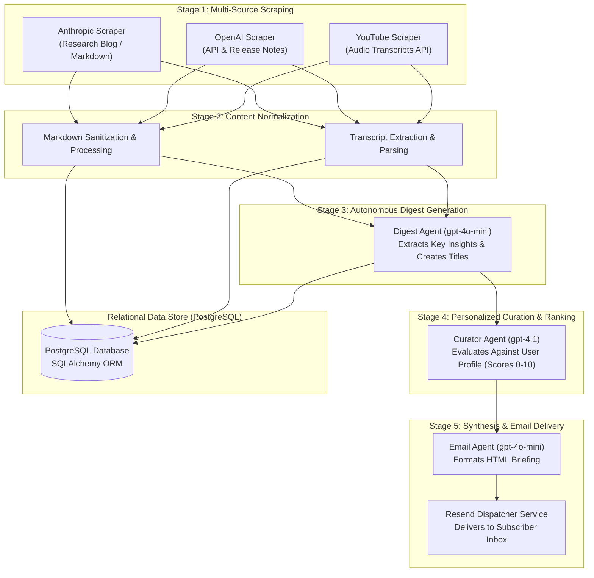

# 📰 Autonomous Multi-Agent AI News & Intelligence Aggregator

[](https://python.org)
[](https://github.com/S23rez)
[](https://openai.com)
[](#)
[](https://postgresql.org)
[](https://docker.com)

A production-grade, autonomous multi-agent intelligence pipeline engineered by **Odunuga Fatai Olayinka**. The system continuously monitors high-velocity AI research publications, laboratory announcements, and technical media feeds, using autonomous LLM agents to extract, filter, summarize, rank, and deliver high-signal intelligence digests.

---

## 🏗️ Multi-Agent System Architecture

The pipeline executes a coordinated 5-stage workflow orchestrated by `daily_runner.py`:



---

## 🤖 Autonomous Agents Breakdown

### 1. 📝 Digest Agent (`app/agent/digest_agent.py`)
- **Engine:** `gpt-4o-mini` with strict structured output formatting (`DigestOutput` Pydantic model).
- **Function:** Distills dense articles, research papers, and video transcripts (up to 8,000 tokens) into concise, 2-3 sentence summaries highlighting actionable engineering takeaways and implications while discarding marketing filler.
- **Output Schema:**
  ```python
  class DigestOutput(BaseModel):
      title: str      # 5-10 word compelling technical title
      summary: str    # High-density 2-3 sentence synthesis
  ```

### 2. 🎯 Curator Agent (`app/agent/curator_agent.py`)
- **Engine:** `gpt-4.1` with custom temperature calibration (`0.3`) for deterministic, objective evaluation.
- **Function:** Analyzes candidate digests against the subscriber's detailed persona profile (`app/profiles/user_profile.py`), evaluating technical depth, novelty, and relevance.
- **Scoring & Ranking:** Assigns a granular relevance score (`0.0` to `10.0`), an ordered rank position (`1` to `N`), and a structured technical reasoning string for each article.

### 3. 📧 Email Agent (`app/agent/email_agent.py`)
- **Engine:** `gpt-4o-mini`.
- **Function:** Generates personalized daily greeting intros contextualized to current date and top emerging themes, then serializes the ranked digests into responsive Markdown and HTML newsletter layouts.

---

## 🌐 Ingestion & Scraping Modules (`app/scrapers/`)

| Scraper Module | Source | Technique & Extraction Details |
| :--- | :--- | :--- |
| **`anthropic.py`** | Anthropic Research Blog | Scrapes raw HTML, strips boilerplate headers, and converts body content into clean, formatted Markdown text with timestamp metadata. |
| **`openai.py`** | OpenAI Announcements | Ingests official model releases, system updates, and security research publications with GUID tracking. |
| **`youtube.py`** | Designated Channels | Uses `youtube-transcript-api` to extract timestamped audio transcripts without requiring headless browser execution. |

---

## 🗄️ Database Architecture & Data Models (`app/database/`)

Managed via **SQLAlchemy ORM** targeting **PostgreSQL**:

```text
├── youtube_videos       (video_id, title, url, channel_id, published_at, transcript, created_at)
├── openai_articles      (guid, title, url, description, published_at, category, created_at)
├── anthropic_articles   (guid, title, url, description, published_at, category, markdown, created_at)
└── digests              (id, article_type, article_id, url, title, summary, created_at)
```

- **Repository Pattern (`app/database/repositories.py`):** Encapsulates queries, upserts, deduplication checks, and transactions away from the agent logic.
- **Automated Schema Provisioning (`app/database/create_tables.py`):** Automatically initializes and validates tables upon container startup.

---

## 📁 Repository Directory Structure

```text
ai-news-aggregator/
├── 📄 main.py                      # CLI entry point (configurable hours & top_n)
├── 📄 pyproject.toml               # Dependency specification (uv / pip)
├── 📄 uv.lock                      # Deterministic dependency lockfile
├── 📂 docker/
│   └── 📄 docker-compose.yml       # Production PostgreSQL container orchestration
└── 📂 app/
    ├── 📄 daily_runner.py          # 5-stage automated pipeline coordinator
    ├── 📄 runner.py                # Multi-threaded scraping runner
    ├── 📄 config.py                # Monitored channel & target configuration
    ├── 📄 example.env              # Environment variable template
    ├── 📂 agent/                   # Autonomous LLM agent implementations
    │   ├── 📄 curator_agent.py     # gpt-4.1 personalized ranking agent
    │   ├── 📄 digest_agent.py      # gpt-4o-mini structured summary agent
    │   └── 📄 email_agent.py       # gpt-4o-mini newsletter synthesis agent
    ├── 📂 database/                # SQLAlchemy models, sessions, and repositories
    ├── 📂 profiles/                # User persona & technical interest profiles
    ├── 📂 scrapers/                # Web and API extraction engines
    └── 📂 services/                # Transcript cleaning, email dispatch, and ETL
```

---

## 🚀 Setup & Execution

### 1. Prerequisites
- Python 3.11+
- Docker and Docker Compose
- OpenAI API Key
- Resend API Key (for email delivery)

### 2. Environment Configuration
Create an `.env` file inside `app/` (or copy from `app/example.env`):
```env
OPENAI_API_KEY=sk-proj-...
POSTGRES_USER=postgres
POSTGRES_PASSWORD=your_secure_password
POSTGRES_DB=ai_news_db
POSTGRES_HOST=localhost
POSTGRES_PORT=5432
RESEND_API_KEY=re_...
```

### 3. Start Database Infrastructure
```bash
cd docker
docker compose up -d
```

### 4. Run the Pipeline
Execute the full 5-stage automated pipeline via CLI:

```bash
# Default: Process last 24 hours, top 10 ranked digests
python main.py

# Custom parameters: Process last 48 hours, top 5 ranked digests
python main.py 48 5
```

### Expected Output Telemetry:
```text
2026-11-16 02:00:00 - INFO - ============================================================
2026-11-16 02:00:00 - INFO - Starting Daily AI News Aggregator Pipeline
2026-11-16 02:00:00 - INFO - ============================================================
2026-11-16 02:00:01 - INFO - [1/5] Scraping articles from sources...
2026-11-16 02:00:04 - INFO - ✓ Scraped 4 YouTube videos, 2 OpenAI articles, 3 Anthropic articles
2026-11-16 02:00:05 - INFO - [2/5] Processing Anthropic markdown...
2026-11-16 02:00:06 - INFO - [3/5] Processing YouTube transcripts...
2026-11-16 02:00:08 - INFO - [4/5] Creating digests for articles...
2026-11-16 02:00:15 - INFO - [5/5] Generating and sending email digest...
2026-11-16 02:00:18 - INFO - ✓ Email sent successfully with 9 articles
2026-11-16 02:00:18 - INFO - Pipeline completed in 18.2 seconds
```

---

## 👤 Author

**Odunuga Fatai Olayinka**  
Cybersecurity Specialist | Systems & Cloud Security Engineer  
GitHub: [@S23rez](https://github.com/S23rez)
