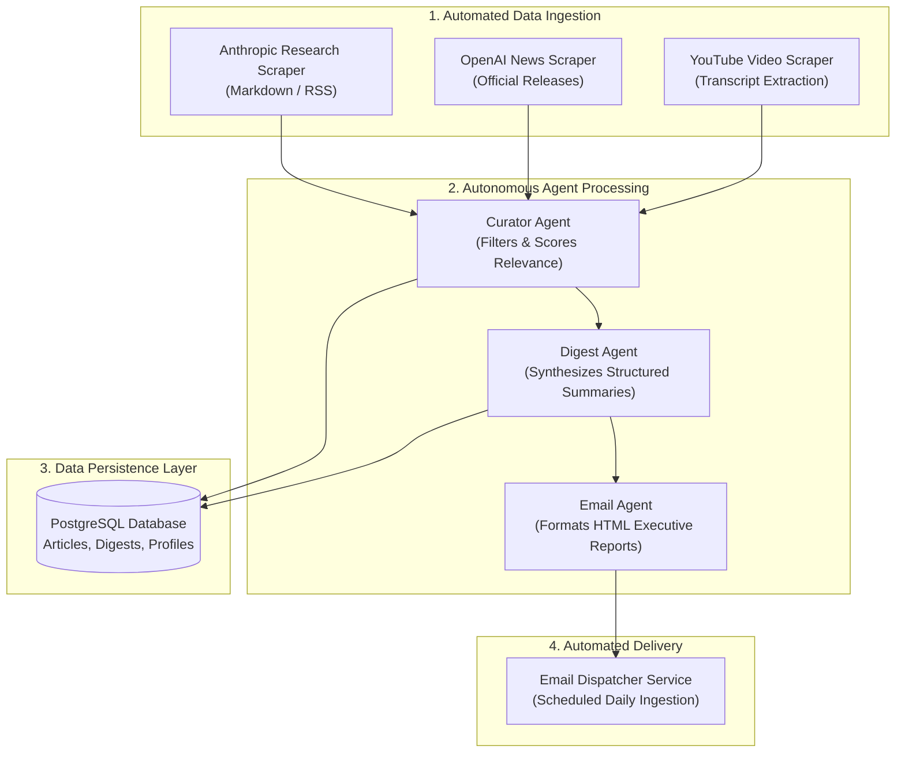

# 📰 Autonomous Multi-Agent AI News & Threat Intelligence Aggregator

[](https://python.org)
[](https://github.com/S23rez)
[](#)
[](https://docker.com)
[](https://postgresql.org)

An autonomous, multi-agent artificial intelligence pipeline that scrapes, ingests, curates, summarizes, and distributes intelligence from leading AI research laboratories and media feeds, engineered by **Odunuga Fatai Olayinka**.

This system showcases how autonomous LLM agents can be orchestrated to monitor high-volume external information feeds, extract critical developments, eliminate noise, store structured findings in a relational database, and dispatch automated intelligence digests.

---

## 🏗️ Multi-Agent Architecture & Pipeline Flow



---

## 🛠️ System Modules & Component Breakdown

### 1. 🌐 Ingestion & Scraping Engine (`app/scrapers/`)
* **Anthropic Scraper (`anthropic.py`):** Fetches official engineering and safety research blog posts, extracting clean markdown text and publication timestamps.
* **OpenAI Scraper (`openai.py`):** Ingests official announcements, API release notes, and research bulletins.
* **YouTube Transcript Scraper (`youtube.py`):** Ingests video metadata and extracts full audio transcripts from designated technical channels without requiring browser rendering.

### 2. 🤖 Autonomous LLM Agents (`app/agent/`)
* **Curator Agent (`curator_agent.py`):** Evaluates incoming articles and transcripts against predefined technical criteria, scoring content relevance, categorizing themes, and weeding out duplicates.
* **Digest Agent (`digest_agent.py`):** Synthesizes lengthy source materials into concise, high-value executive summaries with key technical takeaways.
* **Email Agent (`email_agent.py`):** Transforms structured digest summaries into polished, responsive HTML email newsletters.

### 3. 🗄️ Relational Database & Repository Pattern (`app/database/`)
* **PostgreSQL Engine:** Managed via SQLAlchemy ORM.
* **Data Models (`models.py`):** Normalized schemas for raw articles, curated digests, user subscription preferences, and scraping audit runs.
* **Repository Layer (`repositories.py`):** Implements the repository pattern, decoupling business logic from underlying database queries for testability and maintainability.

### 4. 🐳 Container Orchestration (`docker/`)
* Managed via `docker-compose.yml`, provisioning:
  * A dedicated **PostgreSQL** database container with health checks and volume persistence.
  * The **AI Aggregator** pipeline container with automated environment injection.

---

## 📁 Project Directory

```text
ai-news-aggregator/
├── 📄 README.md                        <- This System Specification Guide
└── 📂 AI Aggregator/ai-news-aggregator/
    ├── 📄 main.py                      <- Pipeline CLI Entry Point
    ├── 📄 pyproject.toml               <- Dependency Manifest (UV / Pip)
    ├── 📂 docker/                      <- Docker Compose Deployment
    │   └── 📄 docker-compose.yml
    └── 📂 app/
        ├── 📄 daily_runner.py          <- Scheduled End-to-End Orchestrator
        ├── 📄 runner.py                <- Multi-Source Scraping Runner
        ├── 📄 config.py                <- Pydantic Settings & Env Management
        ├── 📂 agent/                   <- LLM Agent Implementations
        │   ├── 📄 curator_agent.py
        │   ├── 📄 digest_agent.py
        │   └── 📄 email_agent.py
        ├── 📂 database/                <- SQLAlchemy Models & Connection
        ├── 📂 scrapers/                <- Target-Specific Data Extractors
        └── 📂 services/                <- Transcript & Email Processing
```

---

## 🚀 Execution Instructions

### 1. Environment Configuration
Create an `.env` file inside `app/` based on `app/example.env`:
```env
OPENAI_API_KEY=your_llm_api_key
POSTGRES_USER=postgres
POSTGRES_PASSWORD=your_secure_password
POSTGRES_DB=ai_news_db
POSTGRES_HOST=localhost
POSTGRES_PORT=5432
RESEND_API_KEY=your_email_api_key
```

### 2. Run with Docker Compose
```bash
cd "AI-Projects/ai-news-aggregator/AI Aggregator/ai-news-aggregator/docker"
docker compose up -d
```

### 3. Run the Pipeline Manually
```bash
cd "AI-Projects/ai-news-aggregator/AI Aggregator/ai-news-aggregator"
python -m app.daily_runner
```

---

## 👤 Author

**Odunuga Fatai Olayinka**  
Cybersecurity Specialist | Systems & Cloud Security Engineer  
* GitHub: [@S23rez](https://github.com/S23rez)
